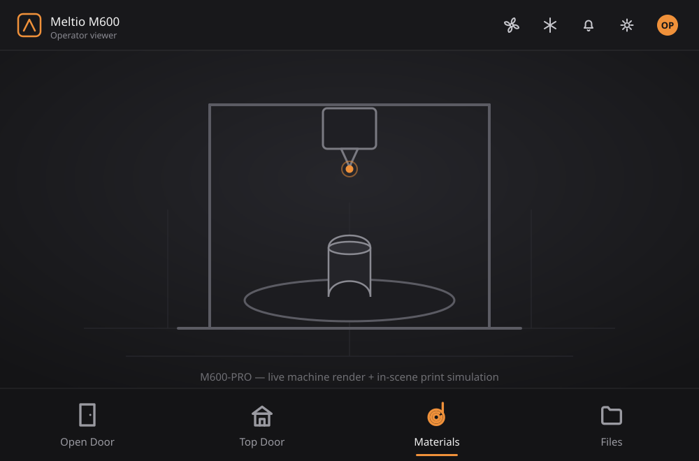

# Meltio URDF Viewer

Browser-based 3D operator HMI for the **Meltio M600-PRO** metal printer.
It renders the machine from its URDF and meshes, lets the operator drive doors,
feeders, utilities and axis jogs from a touch-first interface, embeds the
Meltio slicer, and plays a sliced job back as an in-scene print simulation on
the real gantry motion.



A live capture of the 3D scene: [`docs/screenshot-viewer.png`](docs/screenshot-viewer.png).

---

## Contents

1. [Quick start](#quick-start)
2. [What the app is](#what-the-app-is)
3. [The operator interface](#the-operator-interface)
4. [Setup](#setup)
5. [Running](#running)
6. [Developing](#developing)
7. [Repository layout](#repository-layout)
8. [Troubleshooting](#troubleshooting)
9. [Further reading](#further-reading)

---

## Quick start

Already set up (see [Setup](#setup))? Double-click **`Start-Viewer.bat`**.
It starts the slicer and the viewer if they are not already running, waits
until both answer, and opens the viewer maximised in Edge or Chrome.

Stop both services with **`Stop-Viewer.bat`**.

Viewer URL: **http://127.0.0.1:8090/urdf**

---

## What the app is

Two independent local services, glued at runtime:

| Service | Code | Port | Python env |
|---------|------|------|------------|
| **Viewer** (`avisualizer`) | `apps/dev-host` + repo-root `hmi/` and `viewer/` | 8090 | `.venv` (3.11) |
| **Slicer** (`meltio-platform`) | `_slicer_branch/projects/platform` | 8765 | `venv311` (3.11) |

- The viewer backend is a small **FastAPI** app: sign-in and permissions,
  machine error-code catalogue, slicer proxy, machine-link transport.
- The frontend is a **vanilla JavaScript + Three.js** single-page app. It is
  served as raw ES modules, so **nothing has to be built to run it**. esbuild is
  used only as a CI gate and to bundle the `release` branch for the C# host.
- The viewer talks to the slicer over HTTP (same-origin proxy, configured by
  `AVIS_SLICER_URL`) and browser `postMessage`. Neither service imports the
  other's Python.
- The live-machine link is **off by default**. Add `?machine=1` to the URL to
  enable it; otherwise the scene runs against a mock machine state.

---

## The operator interface

The layout targets a **vertical 1080 × 1920 touch panel** and follows the
Meltio Platform Design System v3: white primary, solid dark grounds, hairline
borders, no orange chrome, 44 px touch targets, with a light mode in Settings.

**3D scene.** Full URDF render of the M600-PRO with image-based lighting,
framed overview and resting cameras, and motion presets. Two door assemblies
ship with baked PBR texture atlases; the optional HRS050 chiller model appears
beside the machine when the chiller is on.

**Top bar.** Flat utility controls. Active ones read as "on" in white with an
underline, like the bottom navigation.

- **Chiller**, **Fan**, **Controls**. Tap toggles. Double tap or long press on
  Fan or Chiller opens a settings card (fan speed and mode, chiller target and
  current temperature).
- **Notifications.** Bell with a live count. Opens the notification centre
  (raised and solved machine events from the error-code catalogue) and a dated,
  persisted history. New critical and warning events also arrive as toasts.
- **Settings** and the **account chip** with the signed-in user's initials.
  Tapping the chip, or "Sign in" in Settings, opens the sign-in form.

**Bottom navigation.** Lucide-style glyphs that animate with the machine state.

- **Open Door** swings the front door; **Top door** shows the chamber cover
  being lifted by a crane sling while the real cover opens, and reverses on
  close.
- **Materials** opens per-feeder loading: Feeder 1 and 2, spool or drum feed
  chosen with two icon buttons, material picked from a design-system listbox,
  load and unload, amount loaded.
- **Files** browses and slices STL files, then **Start print** docks the job.
  During a docked print the bar becomes **Stop / Pause / Slicer**.

**Controls · Move.** Permission-gated jog panel: X/Y/Z jog with a smooth glide,
Home XY, Home Z, and a palpador deploy/retract toggle.

**Accounts and permissions.** Username and password sign-in against
`POST /api/auth/login`. Credentials are PBKDF2 hashes stored in
`apps/dev-host/database/permissions.json` (created on first run; manage
passwords with `apps/dev-host/tools/set_password.py`). Sign-in resolves a level
(Operator, Operator+, Support, God); motion controls and machine commands are
gated to it, and idle sessions sign out. Browser gating is a convenience only.
Machine commands are authorised again server-side against `contract.json`.

**Print flow.** Files → slice → Start print: pre-print homing and probe
routine, bead tracing at real speed in three axes, pause and stop, material
gate and usage tracking. The docked slicer panel and the fullscreen embedded
slicer share one palette.

---

## Setup

### Prerequisites

- **Windows 10/11**
- **Git LFS** (`git lfs install`). Meshes and texture PNGs are LFS objects;
  without it a clone gets text pointers and the scene is empty.
- **Long paths enabled.** Run once:
  `git config --global core.longpaths true`
  (the slicer tree exceeds the 260-character Windows path limit).
- **Python 3.11** on `PATH` (the `py -3.11` launcher is used below).
- **Node.js 22** and **npm**, only if you develop (gate, tests, bundle).
- **Microsoft Edge** or **Google Chrome**.
- About 1 GB of disk for the two virtual environments.

### Install (one time, PowerShell, repo root)

The launcher expects exactly these two folder names.

```powershell
# 1. Slicer environment
py -3.11 -m venv venv311
.\venv311\Scripts\python.exe -m pip install --upgrade pip
.\venv311\Scripts\python.exe -m pip install -r _slicer_branch\requirements.txt

# 2. Viewer environment
py -3.11 -m venv .venv
.\.venv\Scripts\python.exe -m pip install --upgrade pip
.\.venv\Scripts\python.exe -m pip install -r apps\dev-host\requirements.txt

# 3. Frontend tooling (developers only)
npm ci
```

The first install pulls large native wheels (`open3d`, `trimesh`, `scipy`,
`shapely`, `rtree`) and can take several minutes.

---

## Running

### One click

```
Start-Viewer.bat
```

Idempotent: a service that is already up is left alone. The browser opens with
a fresh cache-bust. `Stop-Viewer.bat` shuts both services down.

### Manual (two terminals)

```powershell
# Terminal 1: slicer
$env:PYTHONPATH = "$PWD\_slicer_branch\projects\platform\src"
.\venv311\Scripts\python.exe -m uvicorn meltio_platform.slicer.web.app:create_app --factory --host 127.0.0.1 --port 8765

# Terminal 2: viewer
$env:PYTHONPATH        = "$PWD\apps\dev-host\src"
$env:AVIS_SLICER_URL   = "http://127.0.0.1:8765"
$env:AVIS_SLICER_UI_URL = "http://127.0.0.1:8765"
.\.venv\Scripts\python.exe -m uvicorn avisualizer.web.app:create_app --factory --host 127.0.0.1 --port 8090
```

Then open http://127.0.0.1:8090/urdf.

### Kiosk display

For a taskbar-free panel run the browser fullscreen: press **F11**, or launch
with `--kiosk` or `--app=http://127.0.0.1:8090/urdf`. To make the launcher do
this, change `--start-maximized` to `--kiosk` in `launch-viewer.ps1`.

---

## Developing

Read [`CONTRIBUTING.md`](CONTRIBUTING.md) and [`AGENTS.md`](AGENTS.md) before
your first change. The short version:

- **Where code goes.** What the scene shows → `viewer/` (Three.js, no DOM
  except under `viewer/overlays/`). Hardware or UI state → `hmi/` (DOM, never
  imports `three`). Nothing new goes into the legacy `urdf_viewer.js`.
- **Every frontend PR must pass the gate.** CI runs the same nine checks and
  `main` is protected.

  ```bash
  bash gate.sh
  ```

  Syntax, import resolution, machine-command contract, partition boundaries,
  ESLint, unit tests plus build proof, entry check, DOM contract, dead lookups.
  If gate 8 regenerates `contract-dom.json`, review and commit it.
- **Backend tests.**

  ```powershell
  .\.venv\Scripts\python.exe -m pytest apps\dev-host\tests
  .\venv311\Scripts\python.exe -m pytest _slicer_branch\projects\platform\tests
  ```
- **Boot check.** With the viewer running, load the page in a real browser
  and fail on any console error:

  ```bash
  node tools/check_boot.mjs
  ```
- **Contracts.** `contract.json` (machine commands, host-owned, enforced
  server-side), `contract-dom.json` and `contract-http.json` (generated, never
  hand-edited). The `release` branch is published by a workflow; never commit
  to it.
- **Assets.** URDF and GLB meshes live in `apps/dev-host/assets/M600_PRO`,
  texture atlases in its `Textures/` folder (2K in use, 4K originals in
  `Textures/4k/`). Python edits need a server restart; static edits only need
  a hard reload.

---

## Repository layout

```
.
├─ Start-Viewer.bat / Stop-Viewer.bat   one-click start and stop
├─ launch-viewer.ps1                    launcher logic
├─ hmi/                                 UI-side frontend partition (DOM, state, i18n, ui/)
├─ viewer/                              scene-side partition (core, robot, sim, effects, overlays, toolpath)
├─ apps/dev-host/                       viewer app: FastAPI backend, static shell, assets, tests
│   ├─ src/avisualizer/web/static/        urdf.html, urdf_viewer.js, urdf_viewer.css
│   ├─ assets/M600_PRO/                   URDF + GLB meshes + Textures/
│   ├─ database/                          error_codes.json, permissions.json (runtime)
│   └─ ARCHITECTURE.md                    map of both apps
├─ _slicer_branch/                      slicer backend (meltio-platform)
├─ tools/                               JS gates, DOM/HTTP contract generators, boot check
├─ tests/js, tests/smoke                frontend unit tests and full-stack smoke
├─ contract*.json                       UI↔host contracts
├─ gate.sh, build.mjs, eslint.config.js frontend gate and bundle
├─ docs/                                README assets and quality evaluation
└─ urdf_viewer/                         legacy docs and scripts
```

Only `meltio_platform.slicer.web.app` runs locally. The rest of
`meltio_platform` (the cloud `web/` shell, `frontend/` React SPA,
`render-service/`) is a dormant cloud product the launcher never starts.

`.venv`, `venv311` and `node_modules` are not tracked.

---

## Troubleshooting

| Symptom | Fix |
|---------|-----|
| Port already in use | A previous instance is running. `Stop-Viewer.bat`, then start again. |
| Empty 3D scene | Git LFS is missing. `git lfs install`, then `git lfs pull`. |
| "Filename too long" on clone | `git config --global core.longpaths true`, then clone again. |
| Bottom buttons cut off | The browser is not fullscreen and the taskbar overlaps. Use F11 or `--kiosk`. |
| CSS or JS change not visible | Assets are cache-busted with `?v=`; hard-reload with Ctrl+F5. |
| `open3d` fails to install | The environment must be Python 3.11. |
| Slow first load | Texture PNGs download once per browser profile; subsequent loads are cached. |

---

## Further reading

- [`apps/dev-host/ARCHITECTURE.md`](apps/dev-host/ARCHITECTURE.md). Both apps,
  the load → slice → print flow, endpoints and the postMessage bridge.
- [`CONTRIBUTING.md`](CONTRIBUTING.md). Exact commands and conventions.
- [`AGENTS.md`](AGENTS.md). Partition rules and extraction patterns.
- [`TODO.md`](TODO.md). Per-change checklist (Spanish).
- [`_slicer_branch/projects/platform/STYLEGUIDE.md`](_slicer_branch/projects/platform/STYLEGUIDE.md). UI tokens and component classes.
- [`CLAUDE.md`](CLAUDE.md). Guidance for AI coding agents.

---

*Internal / proprietary. Meltio. Not for public distribution.*
